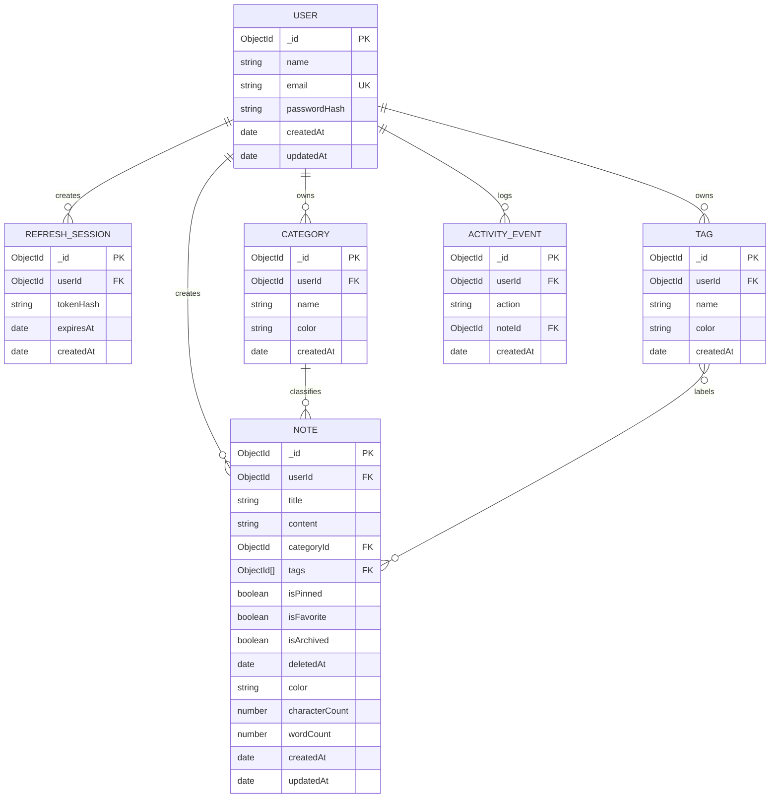

# NoteSpace System Architecture

## 1. Overview

**NoteSpace** is a full-stack, enterprise-grade notes management application built with TypeScript, Node.js/Express, MongoDB (via Mongoose), React, Vite, Tailwind CSS, and TanStack Query.

```
┌────────────────────────────────────────────────────────┐
│                   Client (SPA)                         │
│  React 18 + TypeScript + Vite + Tailwind + shadcn/ui    │
│  React Router v6 + TanStack Query + React Hook Form    │
└───────────────────────────┬────────────────────────────┘
                            │ HTTPS / REST JSON
                            │ (Bearer JWT + HttpOnly Cookie)
┌───────────────────────────▼────────────────────────────┐
│                  Server (Express API)                  │
│  Helmet + CORS allowlist + Rate Limiting + Pino Logs   │
│  Auth, Notes, Categories, Tags, Trash, Search, Metrics │
└───────────────────────────┬────────────────────────────┘
                            │ Mongoose ODM
┌───────────────────────────▼────────────────────────────┐
│                    MongoDB Atlas / 8.0                 │
│  Collections: Users, Notes, Categories, Tags, Sessions │
│  Compound, TTL, and Full-Text Indexes                  │
└────────────────────────────────────────────────────────┘
```

---

## 2. Technology Choices & Rationale

| Layer | Technology | Rationale |
|---|---|---|
| **Frontend Framework** | React 18 + Vite | Lightning-fast HMR, optimized production tree-shaking, and type safety with TypeScript. |
| **State Management** | TanStack Query v5 | Automatic caching, background refetching, mutation lifecycle, and optimistic updates. |
| **Styling** | Tailwind CSS + Radix UI | Accessible headless primitives paired with responsive utility tokens. |
| **Backend Framework** | Node.js + Express + TypeScript | Modular MVC pattern with Zod schema validation and centralized error handling. |
| **Database** | MongoDB 8.0 + Mongoose | Flexible document model for hierarchical and tagged notes with schema-level validation. |
| **Authentication** | Dual-Token JWT (Access + Refresh) | Short-lived access token (15m) + secure rotating HttpOnly cookie (7d). |

---

## 3. Data Model & Schema Relationships



---

## 4. Key Architectural Patterns

### Soft Deletion & Trash Lifecycle
- Deleting a note sets `deletedAt: new Date()` instead of immediately dropping the document.
- Notes in trash are automatically cleaned up after 30 days via a MongoDB TTL index or manual "Empty Trash".
- Restoring simply sets `deletedAt: null`.

### Full-Text Search
- Text indexes are maintained on `title` and `content`.
- Search queries use MongoDB `$text` search with `$meta: "textScore"` relevance sorting, supplemented by regex fallback for prefix/partial matches.

### Aggregation Pipeline Analytics
- Dashboard metrics run on MongoDB aggregation pipelines, calculating live metrics across categories, tags, pinned/favorited items, and 7/30-day activity timelines.
